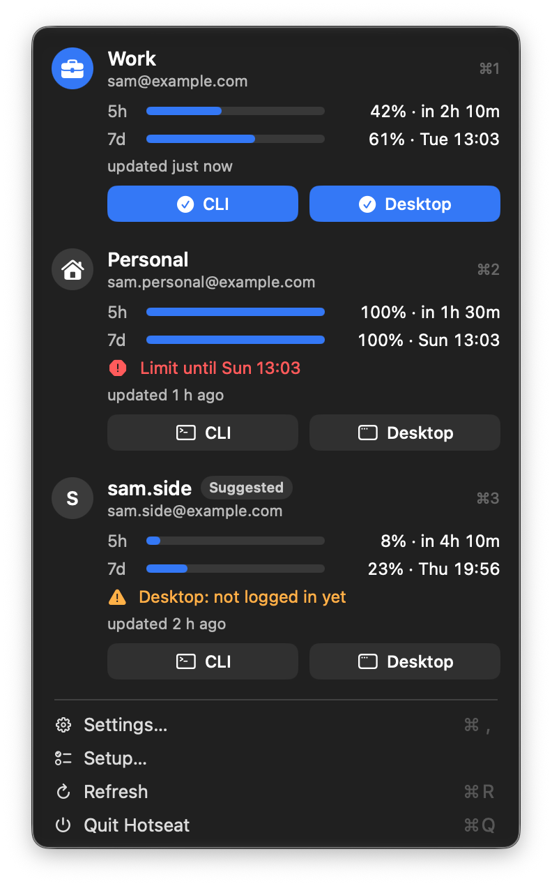
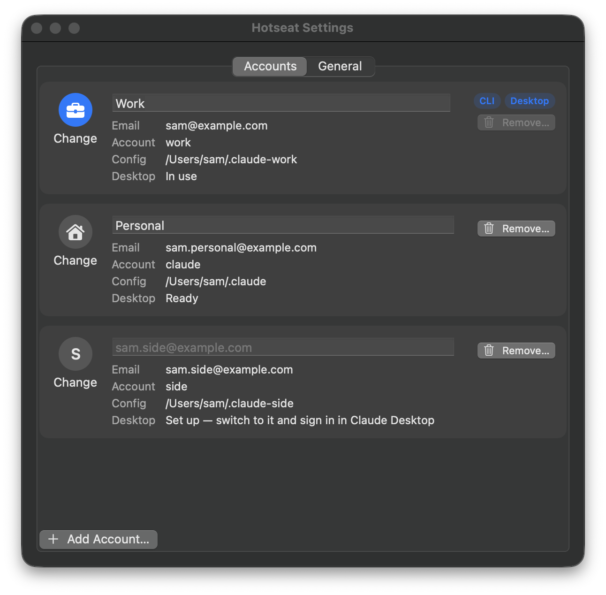
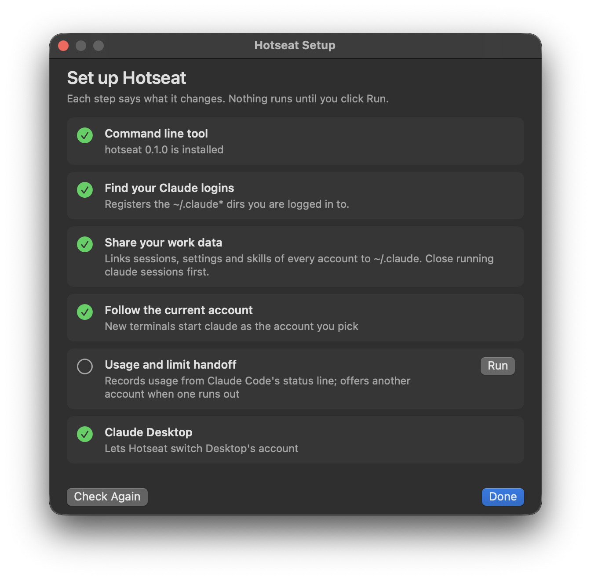

# Hotseat

**Claude account switcher for macOS: switch accounts, keep your place.**

Hotseat is for people who have more than one Claude account, such as work and personal. It switches Claude Code and Claude Desktop between them in one click. Your sessions, settings, skills and history stay put, so when one account runs out you continue the same conversation on another. It never touches your login tokens.



macOS 14 or later. Free and open source (MIT). Not affiliated with Anthropic.

## Why

Switching Claude accounts by hand means logging out and back in. You lose your place, the Code session list in Claude Desktop belongs to one account only, and `claude --resume` in a second config dir sees none of your history. Hotseat keeps one workspace and lets accounts take turns in it, like players on a hotseat.

## What you get

- **A menu bar view of every account.** It shows 5-hour and weekly usage, when each resets, how old the numbers are, and which account the terminal (CLI) and Claude Desktop each use.
- **One-click switching.** Click an account to move both the CLI and Claude Desktop to it. Use its **CLI** or **Desktop** button to move just one of them. Desktop restarts on the session you were in. The Code session list is the same for every account.
- **Shared work data.** Every account sees the same `projects/`, history, settings, skills and MCP servers, so `claude --resume` works across accounts.
- **Limit handoff.** When a CLI session hits a usage limit, a dialog offers to continue that session on the account with the most quota left. Nothing switches until you click.
- **Names and avatars.** Accounts show your own note (for example "Work") or the email's name part. Pick a symbol for each one in Settings.
- **Guided setup and clean uninstall.** The app walks you through setup and says what each step changes. `hotseat uninstall` takes it all back out.



## Install

**Homebrew.** This builds on your Mac, so macOS does not block the app.

```sh
brew install zahT3/tap/hotseat
cp -R "$(brew --prefix)/opt/hotseat/Hotseat.app" ~/Applications/
open ~/Applications/Hotseat.app
```

**Download.** Get `Hotseat-<version>-macos.zip` from [Releases](https://github.com/zahT3/hotseat/releases), unzip it, move `Hotseat.app` to `~/Applications`, then run once:

```sh
xattr -dr com.apple.quarantine ~/Applications/Hotseat.app
```

Hotseat is not notarized by Apple (that costs money, and Hotseat is free). Without that command, macOS refuses to open an app downloaded from the internet.

**From source.** You need Go 1.26 and the Xcode Command Line Tools. Xcode itself is not needed.

```sh
go build -o ~/.local/bin/hotseat ./cmd/hotseat
macos/build-app.sh --install
```

## Quick start

Open Hotseat. The Setup window lists each step, says what it changes, and runs it when you click **Run**:



1. Install the `hotseat` command line tool (the app carries it).
2. Find your Claude logins (`~/.claude`, `~/.claude2`, `~/.claude-work`, ...). No logins yet? Run `claude` once and log in.
3. Share work data between them.
4. Make new terminals start `claude` as the account you pick.
5. Record usage and set up limit handoff.
6. Let Hotseat manage Claude Desktop.

Add more accounts in **Settings → Accounts → Add Account…**. Terminal opens with Claude's own login.

## How it works

Claude Code supports one config dir per account (`CLAUDE_CONFIG_DIR`) and keeps each dir's login in its own keychain entry. Hotseat builds on that:

- `~/.claude` holds the single real copy of your work data (`projects/`, `history.jsonl`, `file-history/`, `skills/`, `settings.json`, ...). Every other account dir links those entries back to `~/.claude` and keeps only its own login and caches.
- A small `claude` shim follows the account you pick. Aliases that set `CLAUDE_CONFIG_DIR` themselves, such as `alias claude2='CLAUDE_CONFIG_DIR=~/.claude2 claude'`, keep a terminal pinned to one account.
- Claude Desktop holds one login at a time, so each account gets its own complete Desktop data dir.
  - The current account's dir sits at the real path, `~/Library/Application Support/Claude`. Opening Desktop from the Dock, from Spotlight or after an update always opens the current account.
  - The others are parked in `~/.config/hotseat/desktop/profiles/<account>/`.
  - A switch quits Desktop (it waits; it never force-kills) and carries the Code session list, MCP servers, preferences, extensions and scratch work over. It then swaps the two dirs and reopens Desktop on your session through Claude's `claude://resume` link.
- Usage numbers come only from what Claude Code hands its status line and from Claude Desktop's local usage history. An account you have not used for a while shows its last known numbers and how old they are.

## What Hotseat never does

- **It never reads, copies or stores tokens or credentials.** That covers `.credentials.json`, the keychain, `CLAUDE_CODE_OAUTH_TOKEN`, and Desktop's cookies and storage. From `.claude.json` it reads only the account and organization IDs, the `mcpServers` key and the email address. Logins always go through Claude's own login.
- **It never switches accounts on its own.** Every switch is a click or a command. There is no rotation and no account pool, and no proxy.
- **It never deletes your data.** Anything it replaces or removes goes into `~/.config/hotseat/backups/`.
- **The app makes no network requests.** It runs the `hotseat` CLI and nothing else.

## Command line

```sh
hotseat accounts                 # registered accounts; * marks the current one
hotseat use work [--yes]         # CLI and Desktop to `work` (--yes lets it restart a running Desktop)
hotseat use work --cli-only      # only new terminal sessions
hotseat desktop switch work      # only Claude Desktop
hotseat usage                    # 5-hour and weekly usage, reset times, data age
hotseat add work                 # new account: config dir + Claude's own login
hotseat remove work --yes        # sign out, move its files into a backup
hotseat note work "Work"         # your label for it
hotseat icon work briefcase.fill # an SF Symbol name or an emoji
hotseat doctor                   # drift, logins that changed, setup problems
hotseat setup status             # which setup steps are done
hotseat uninstall --yes          # remove the shim, status line and hook
```

<details>
<summary>All commands</summary>

```sh
hotseat init                 # find existing ~/.claude* logins and register them
hotseat share plan           # show what would be linked or merged (read-only)
hotseat share apply          # do it; refuses while any claude process is running
hotseat share backups        # list backups
hotseat share rollback <id>  # undo an apply
hotseat share set <name> shared|local
hotseat shim install|uninstall
hotseat statusline install|uninstall
hotseat hook install|uninstall
hotseat desktop adopt [<account> <dir>]
hotseat desktop add <account>
hotseat desktop status
hotseat desktop recover      # finish or undo a switch that was interrupted
hotseat panel --json         # everything the menu bar app shows
```

Every command accepts `--json`.

</details>

**Sharing details.** `share apply` merges each account's `history.jsonl` into the shared one and copies entries that only exist in an account dir into `~/.claude`. When both sides have a different version of a file, the shared copy wins, the account's copy stays in the backup, and `apply` lists those paths. MCP servers are synced as a union: every account gets every server.

**Rolling back.** Close every claude session first. A rollback puts each file back as it was before the apply. Files that changed since then are moved into `backups/<id>/rollback-removed/` instead of being overwritten. For `.claude.json`, only the `mcpServers` key is restored.

**In the terminal**, the status line reads `Work · 5h 42% · 7d 61%`. If you had your own status line, it is kept and shown first.

## Uninstall

```sh
hotseat uninstall --yes   # removes the claude shim, the status line and the StopFailure hook
```

Your data stays:
- the links between `~/.claude*` dirs (undo them with `hotseat share backups` and `hotseat share rollback <id>`);
- `~/.config/hotseat` (backups, parked Claude Desktop profiles, usage records);
- the app itself.

A status line you changed after installing Hotseat is left as it is.

## FAQ

**Is using several accounts allowed?** Anthropic's [Consumer Terms](https://www.anthropic.com/legal/consumer-terms) forbid sharing account credentials and "bypassing any of our systems or protective measures". They have no rule about holding more than one account. Hotseat is built for people who legitimately have several accounts, such as work and personal. It is not built for pooling accounts to get around limits. People have reported suspensions when many accounts run from one machine. Read the terms and judge for yourself. Hotseat does not change how Claude sees your usage.

**Will a Claude Desktop update break it?** Desktop's data layout is not a public interface. Hotseat checks which account each profile is logged in to before every switch, and `hotseat doctor` reports anything it does not recognise. Updates so far have not needed changes, but one could.

**How is it different from other account switchers?** Most switchers swap tokens or the login only, so each account still sees its own history. Hotseat keeps one shared workspace: the same sessions, settings and Desktop session list on every account. It does this without ever reading a token.

**Why one config dir per account?** Claude Code stores one login per config dir. The dirs are tiny, because the work data is linked to `~/.claude`.

**Do not use Log out in Claude Desktop to change accounts.** It signs that account out on Anthropic's side, and its profile has to log in again. Switch with Hotseat instead.

**Windows or Linux?** Not yet. Hotseat is macOS only.

**The app does not see my `HOTSEAT_HOME`.** Apps do not inherit variables set in your shell. If you use one, point the app at a wrapper script: `defaults write io.github.zahT3.hotseat hotseatPath /path/to/script`.

## Files

- `~/.config/hotseat/accounts.json`: registered accounts, notes and icons (override the dir with `HOTSEAT_HOME`)
- `~/.config/hotseat/current`: the current account
- `~/.config/hotseat/backups/`: everything Hotseat replaced or removed
- `~/.config/hotseat/desktop/`: parked Claude Desktop profiles and switch state
- `~/.config/hotseat/bin/claude`: the shim

## Contributing

See [CONTRIBUTING.md](CONTRIBUTING.md). Report security issues as described in [SECURITY.md](SECURITY.md).

## License

MIT
