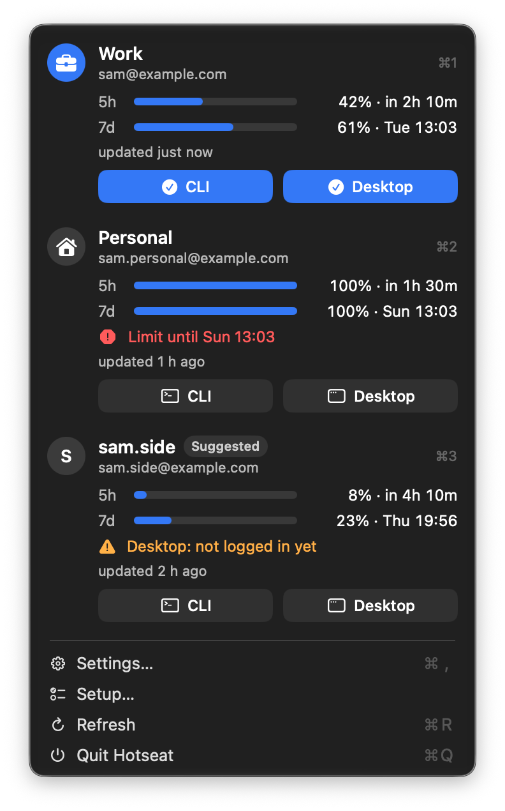
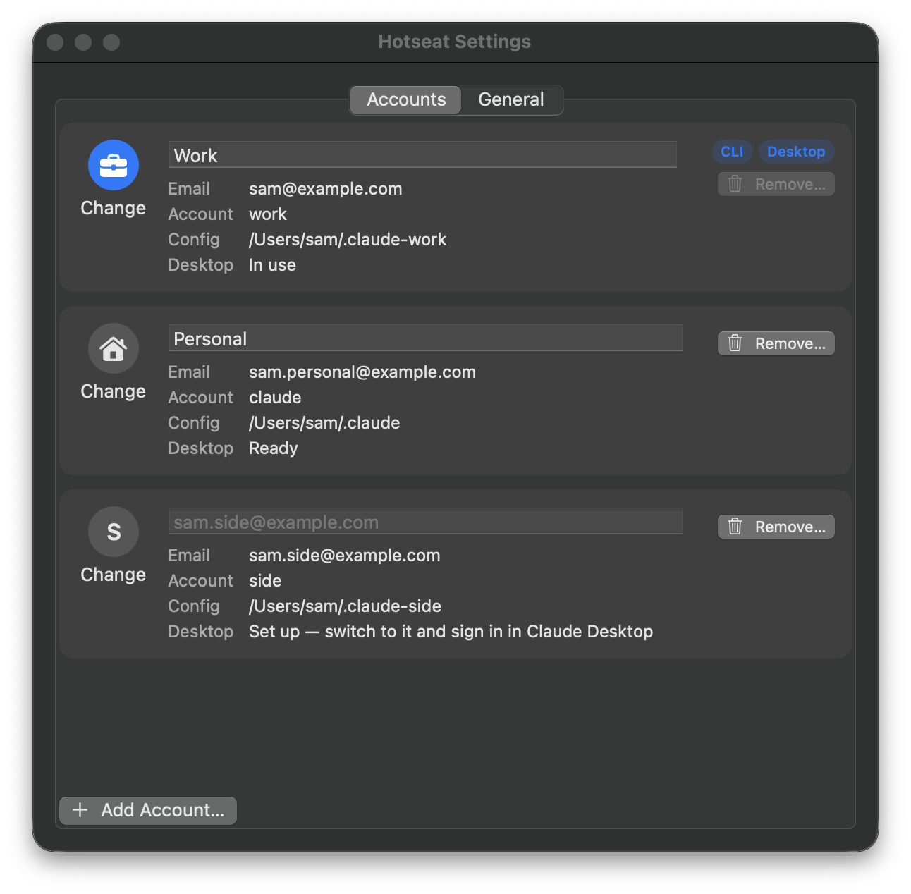
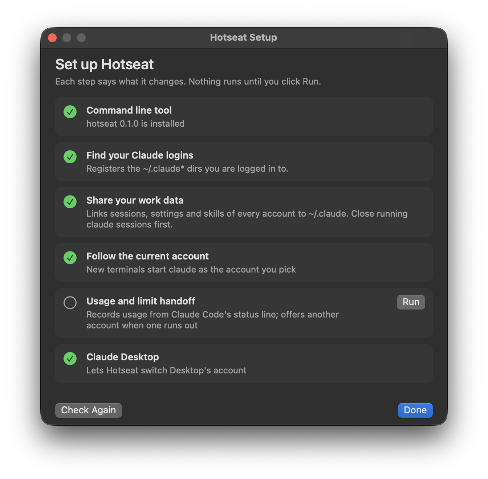

# Hotseat

[English](README.md) · **简体中文**

**macOS 上的 Claude 账号切换器：换账号，不丢进度。**

Hotseat 给有多个 Claude 账号的人用，比如一个工作号、一个个人号。点一下，就能把 Claude Code 和 Claude Desktop 切到另一个账号。会话、设置、skills 和历史都留在原处，所以在一个账号下开始的对话，可以换到另一个账号接着聊。它从不碰你的登录 token。


需要 macOS 14 或更高版本。免费开源（MIT）。与 Anthropic 无关。

> 本文译自英文版 [README.md](README.md)，两者不一致时以英文版为准。

## 为什么做它

手动切换 Claude 账号，就得退出再登录。进度丢了；Claude Desktop 里的 Code 会话列表只属于一个账号；在第二个配置目录里跑 `claude --resume`，也看不到你的任何历史。Hotseat 只保留一个工作区，让账号轮流使用，就像轮流坐同一把椅子（hotseat）的玩家。

## 功能



- **菜单栏里看所有账号。** 显示 5 小时和每周用量、各自什么时候重置、数据是多久前的，以及终端（CLI）和 Claude Desktop 分别在用哪个账号。
- **一键切换。** 点一个账号，CLI 和 Claude Desktop 一起切过去。只想切其中一个，就点它的 **CLI** 或 **Desktop** 按钮。Desktop 重启后回到你刚才的会话。每个账号看到的 Code 会话列表都一样。
- **共享工作数据。** 每个账号看到同一份 `projects/`、历史、设置、skills 和 MCP 服务器，所以 `claude --resume` 可以跨账号用。
- **接着上次继续。** CLI 会话因为用量上限停下时，会弹窗问你要不要换另一个账号重新打开这个会话。你不点，就什么都不切。
- **名字和头像。** 账号显示你写的备注（比如 "Work"），没有备注就显示邮箱 @ 前面的部分。在 Settings 里可以给每个账号选一个图标。
- **引导式安装，干净卸载。** App 会一步步带你完成安装，并说明每一步改了什么。`hotseat uninstall` 能把它全部撤掉。



## 安装

**Homebrew。** 会在你的 Mac 上本地编译，所以 macOS 不会拦这个 App。

```sh
brew install zahT3/tap/hotseat
mkdir -p ~/Applications
cp -R "$(brew --prefix)/opt/hotseat/Hotseat.app" ~/Applications/
open ~/Applications/Hotseat.app
```

**下载。** 从 [Releases](https://github.com/zahT3/hotseat/releases) 下载 `Hotseat-<version>-macos.zip`，解压后把 `Hotseat.app` 放进 `~/Applications`（没有这个文件夹就新建一个），然后运行一次：

```sh
xattr -dr com.apple.quarantine ~/Applications/Hotseat.app
```

Hotseat 没有经过 Apple 公证（公证要花钱，而 Hotseat 是免费的）。不运行这条命令，macOS 会拒绝打开从网上下载的 App。

**从源码编译。** 需要 Go 1.26 和 Xcode Command Line Tools，不需要装 Xcode 本身。

```sh
go build -o ~/.local/bin/hotseat ./cmd/hotseat
macos/build-app.sh --install
```

## 快速上手

打开 Hotseat。Setup 窗口列出每一步，说明它会改什么；点 **Run** 就执行这一步：



1. 安装 `hotseat` 命令行工具（App 里自带）。
2. 找到你已有的 Claude 登录（`~/.claude`、`~/.claude2`、`~/.claude-work` 等）。还没有登录过？先运行一次 `claude` 并登录。
3. 让这些账号共享工作数据。
4. 让新开的终端用你选定的账号启动 `claude`。
5. 记录用量；会话因为上限停下时，提示你换另一个账号接着用。
6. 让 Hotseat 接管 Claude Desktop。

要添加更多账号，在 **Settings → Accounts → Add Account…** 里操作。它会打开终端，走 Claude 自己的登录流程。

命令行工具装在 `~/.local/bin/hotseat`。如果终端里找不到 `hotseat`，把这个目录加进 PATH，例如 `echo 'export PATH="$HOME/.local/bin:$PATH"' >> ~/.zshrc`。

## 工作原理

Claude Code 支持每个账号用一个配置目录（`CLAUDE_CONFIG_DIR`），每个目录的登录信息存在各自的钥匙串条目里。Hotseat 就建立在这一点上：

- `~/.claude` 存放唯一一份真实的工作数据（`projects/`、`history.jsonl`、`file-history/`、`skills/`、`settings.json` 等）。其他账号目录把这些条目链接回 `~/.claude`，自己只保留登录信息和缓存。
- 一个小小的 `claude` shim 会跟随你选定的账号。自己设置了 `CLAUDE_CONFIG_DIR` 的别名，比如 `alias claude2='CLAUDE_CONFIG_DIR=~/.claude2 claude'`，会让那个终端固定用一个账号。
- Claude Desktop 一次只能登录一个账号，所以每个账号都有一份完整的 Desktop 数据目录。
  - 当前账号的目录放在真实路径 `~/Library/Application Support/Claude`。无论从 Dock、Spotlight 打开 Desktop，还是更新后重新打开，打开的都是当前账号。
  - 其他账号的目录暂存在 `~/.config/hotseat/desktop/profiles/<account>/`。
  - 切换时会先退出 Desktop（它会等待，从不强制结束进程），把 Code 会话列表、MCP 服务器、偏好设置、扩展和临时工作带过去，然后交换两个目录，再通过 Claude 的 `claude://resume` 链接在你的会话上重新打开 Desktop。
- 用量数字只来自 Claude Code 传给状态栏的数据，以及 Claude Desktop 本地的用量记录。一段时间没用的账号，显示最后一次已知的数字和它有多旧。

## Hotseat 绝不会做的事

- **从不读取、复制或保存 token 和凭据。** 包括 `.credentials.json`、钥匙串、`CLAUDE_CODE_OAUTH_TOKEN`，以及 Desktop 的 cookies 和存储。从 `.claude.json` 里只读账号和组织 ID、`mcpServers` 键和邮箱地址。登录始终走 Claude 自己的登录流程。
- **从不自己切换账号。** 每次切换都来自你的一次点击或一条命令。没有轮换，没有账号池，也没有代理。
- **从不删除你的数据。** 它替换或移除的东西都会放进 `~/.config/hotseat/backups/`。
- **App 不发任何网络请求。** 它只运行 `hotseat` 命令行工具。

## 命令行

```sh
hotseat accounts                 # 已注册的账号；* 标出当前账号
hotseat use work [--yes]         # CLI 和 Desktop 都切到 work（--yes 允许重启正在运行的 Desktop）
hotseat use work --cli-only      # 只影响新开的终端会话
hotseat desktop switch work      # 只切 Claude Desktop
hotseat usage                    # 5 小时和每周用量、重置时间、数据新旧
hotseat add work                 # 新账号：建配置目录，走 Claude 自己的登录
hotseat remove work --yes        # 退出登录，把它的文件移进备份
hotseat note work "Work"         # 给它起个备注
hotseat icon work briefcase.fill # SF Symbol 名称或一个 emoji
hotseat doctor                   # 检查偏差、变动过的登录和安装问题
hotseat setup status             # 哪些安装步骤已完成
hotseat uninstall --yes          # 移除 shim、状态栏和 hook
```

<details>
<summary>全部命令</summary>

```sh
hotseat init                 # 找到已有的 ~/.claude* 登录并注册
hotseat share plan           # 显示会链接或合并哪些内容（只读）
hotseat share apply          # 执行；有 claude 进程在运行时会拒绝
hotseat share backups        # 列出备份
hotseat share rollback <id>  # 撤销一次 apply
hotseat share set <name> shared|local
hotseat shim install|uninstall
hotseat statusline install|uninstall
hotseat hook install|uninstall
hotseat desktop adopt [<account> <dir>]
hotseat desktop add <account>
hotseat desktop status
hotseat desktop recover      # 完成或撤销一次被中断的切换
hotseat panel --json         # 菜单栏 App 显示的全部内容
```

每条命令都支持 `--json`。

</details>

**共享的细节。** `share apply` 会把每个账号的 `history.jsonl` 合并进共享的那一份，并把只存在于某个账号目录里的条目复制到 `~/.claude`。两边有同一个文件的不同版本时，以共享的那份为准，账号自己的那份留在备份里，`apply` 会列出这些路径。MCP 服务器按并集同步：每个账号都拿到所有服务器。

**回滚。** 先关掉所有 claude 会话。回滚会把每个文件恢复成 apply 之前的样子。apply 之后又改过的文件不会被覆盖，而是移到 `backups/<id>/rollback-removed/`。`.claude.json` 只恢复 `mcpServers` 这个键。

**在终端里**，状态栏显示为 `Work · 5h 42% · 7d 61%`。如果你原来有自己的状态栏，会保留下来，并显示在前面。

## 卸载

```sh
hotseat uninstall --yes   # 移除 claude shim、状态栏和 StopFailure hook
```

这些数据会保留：
- `~/.claude*` 目录之间的链接（用 `hotseat share backups` 和 `hotseat share rollback <id>` 撤销）；
- `~/.config/hotseat`（备份、暂存的 Claude Desktop 配置、用量记录）；
- App 本身。

安装 Hotseat 之后你自己改过的状态栏，会原样保留。

## 常见问题

**用多个账号是允许的吗？** 请自己阅读 Anthropic 的条款并做判断，Hotseat 没法替你回答。下面是写这段文字时（2026 年 10 月）条款里的说法：
- [Consumer Terms](https://www.anthropic.com/legal/consumer-terms) 禁止和任何人共享你的登录或凭据，也禁止 "bypassing any of our systems or protective measures"（绕过其任何系统或保护措施）。条款没有提到多账号。
- [Usage Policy](https://www.anthropic.com/legal/aup) 禁止为了 "to avoid detection"（规避检测）而创建多个账号，禁止用另一个账号绕过封禁，也禁止故意绕过 "capabilities, restrictions, or guardrails established within our products"（产品内设定的能力、限制或防护措施）。

Hotseat 是给确实合法拥有多个账号的人用的，比如工作号和个人号，让他们在这些账号之间共用一个工作区。它不是用来把账号凑在一起绕过用量上限的。

**Claude Desktop 更新后会不会坏掉？** Desktop 的数据结构不是公开接口。每次切换前，Hotseat 都会先确认每个配置登录的是哪个账号；`hotseat doctor` 会报告它不认识的东西。到目前为止的更新都不需要改动，但以后的更新有可能需要。

**它和其他账号切换器有什么不同？** 大多数切换器只换 token 或登录，每个账号看到的仍是各自的历史。Hotseat 保留一个共享的工作区：每个账号都看到同样的会话、设置和 Desktop 会话列表。而且它做到这些，从不读取 token。

**为什么每个账号一个配置目录？** Claude Code 每个配置目录只存一个登录。这些目录很小，因为工作数据都链接到了 `~/.claude`。

**不要用 Claude Desktop 里的 Log out 来换账号。** 那会在 Anthropic 那边让这个账号退出登录，它的配置得重新登录。请用 Hotseat 切换。

**支持 Windows 或 Linux 吗？** 暂时不支持，Hotseat 只支持 macOS。

**App 读不到我的 `HOTSEAT_HOME`。** App 不会继承你在 shell 里设置的变量。如果你用了它，就让 App 指向一个包装脚本：`defaults write io.github.zahT3.hotseat hotseatPath /path/to/script`。

## 文件

- `~/.config/hotseat/accounts.json`：已注册的账号、备注和图标（可用 `HOTSEAT_HOME` 换目录）
- `~/.config/hotseat/current`：当前账号
- `~/.config/hotseat/backups/`：Hotseat 替换或移除的所有东西
- `~/.config/hotseat/desktop/`：暂存的 Claude Desktop 配置和切换状态
- `~/.config/hotseat/bin/claude`：shim

## 参与贡献

见 [CONTRIBUTING.md](CONTRIBUTING.md)（英文）。安全问题请按 [SECURITY.md](SECURITY.md) 里的方式报告。

## 许可证

MIT
